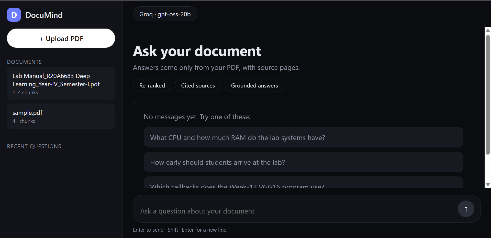
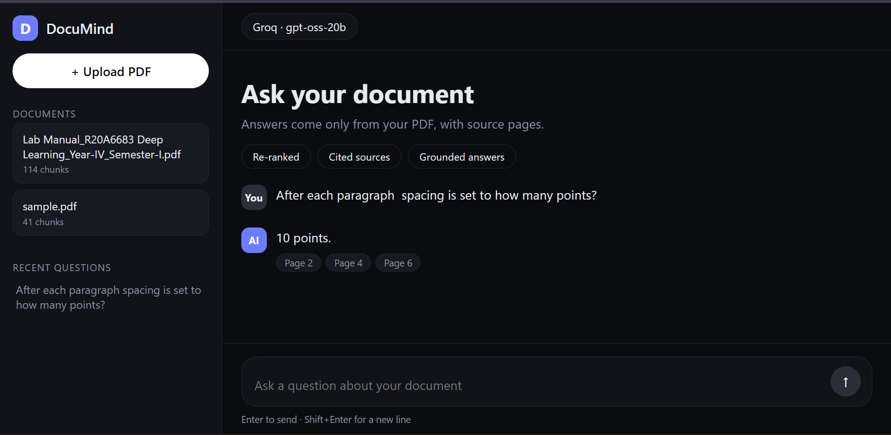
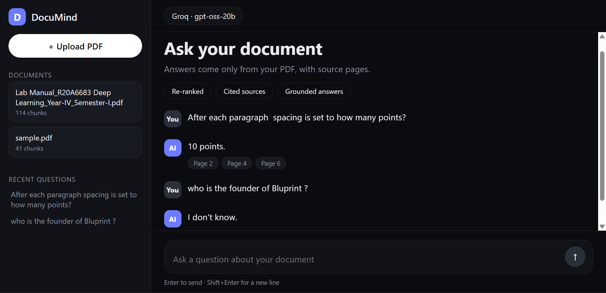
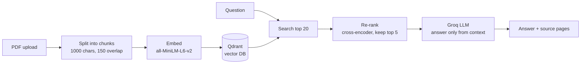

# DocuMind

Ask questions about a PDF and get answers with the exact source pages. If the answer is not in the document, it says "I don't know" instead of guessing.

> Demo video: _coming soon_ · Deployed on AWS EC2 (the live link is only up while I am demoing it, to save cost)







## Features

- Upload a PDF and chat with it (React UI)
- Remembers uploaded documents after a page reload
- Answers come only from the document, with source page numbers
- Re-ranking: a cross-encoder re-orders search results for better accuracy
- Re-uploading the same file replaces its old chunks (no duplicates)
- Measured with a 30-question test set, not guessed
- One command runs everything with Docker (FastAPI serves the React page and the API on one port)
- Deployed on AWS EC2

## How it works



## Tech stack

FastAPI · LangChain · Qdrant · sentence-transformers (all-MiniLM-L6-v2, ms-marco cross-encoder) · Groq (`openai/gpt-oss-20b`) · React (Vite) · Docker Compose · AWS EC2

## Evaluation

I built a test set of 30 questions on a real 68-page PDF (a Deep Learning lab manual): 25 questions with answers in the document and 5 that are not in it. Answers were graded by hand. I changed one thing at a time and measured each change.

| Setup | Fully correct (of 25) | Wrong "I don't know" | Correct "I don't know" (of 5) |
|---|---|---|---|
| Baseline (chunks 512/64) | 14 | 7 | 5 |
| Chunks 1000/150 | 19 | 4 | 5 |
| + Re-ranker | ~19-20 | 3 | 5 |
| + Hybrid BM25 search | no gain, one question got worse, so it is switched off | 4 | 5 |

What I learned:
- Bigger chunks helped the most (14 to 19 correct).
- The re-ranker fixed some exact-code questions and gave fewer false "I don't know" answers.
- Hybrid search did not help on this document, so I left it off.
- Vague questions fail more often. "What noise factor is used?" failed; adding the week and program name made it work.

Known weak spots: counting questions ("how many programs?") and facts spread over several pages. See `eval/` for the questions and saved results.

Run the evaluation yourself (needs Qdrant running):

```bash
python eval/run_eval.py my_run
```

## Run it

You need Docker and a free [Groq API key](https://console.groq.com).

```bash
git clone https://github.com/MoghalPathan/DocuMind.git
cd DocuMind
echo GROQ_API_KEY=your_key_here > .env
docker compose up --build
```

Open http://localhost:8000, click **Upload PDF**, and ask a question. The first start downloads the embedding models, so it takes a few minutes.

Developing the UI: keep the backend running (`docker compose up -d qdrant api`), then `cd web && npm install && npm run dev` and open http://localhost:5173.

## Project structure

```
backend/    FastAPI app: ingest.py, store.py, search.py, answer.py, main.py (also serves the React build)
web/        React (Vite) chat page, built into static files by Docker and served by FastAPI
docs/       screenshots
eval/       30 test questions, evaluation script, saved results
Dockerfile, docker-compose.yml
```

## What I would improve next

- Rewrite vague questions before searching
- Streaming answers
- Automated tests and CI
- Multiple documents with per-document filtering, and login
- RAGAS scores (faithfulness, context precision)

## Author

Naved Korabu · [LinkedIn](https://www.linkedin.com/in/naved-korabu-2b8221434/) · [GitHub](https://github.com/MoghalPathan)
