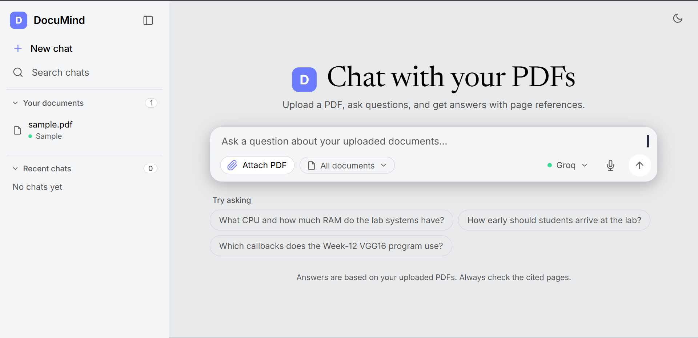
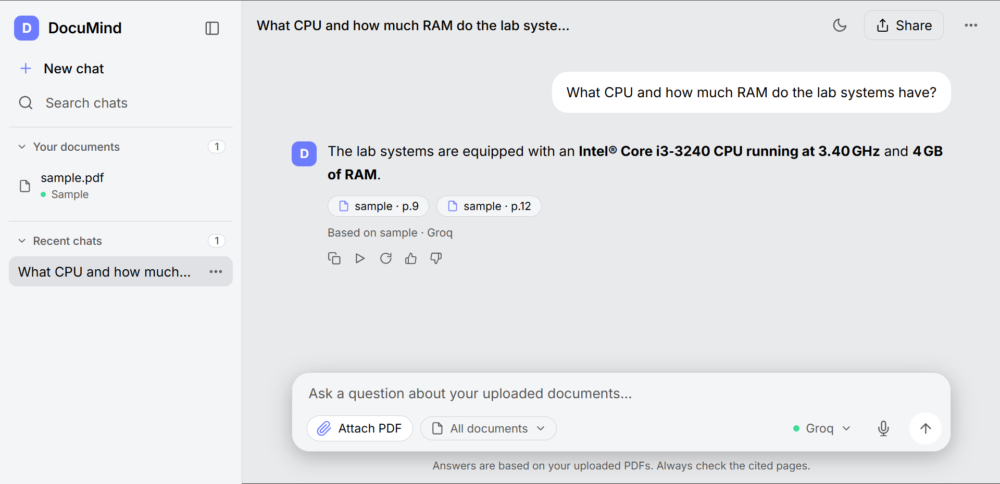
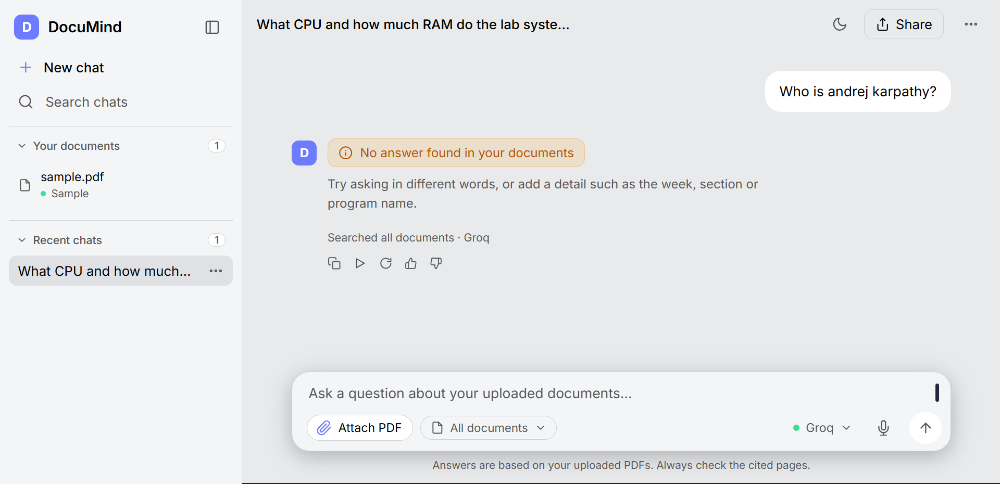

# DocuMind

Ask questions about your files and web pages and get answers with citations (page, slide or part). If the answer is not in the document, DocuMind says "I don't know" instead of guessing.

**Live demo:** https://documindai.duckdns.org (click "Try demo", no sign-up needed)





## Features
- Upload files and chat with them (answers cite the document and the page, slide or part)
- Strict answers: only from your documents, otherwise "I don't know"
- Follow-up questions work (chat memory) and answers can be regenerated
- Login, "Try demo" accounts, per-user documents, upload and rate limits
- Two LLMs to choose from (Groq or Gemini), with automatic backup if one is busy
- Light and dark theme, works on mobile, voice input on https
- Scanned (image-only) PDFs are detected and rejected with a clear message
- Many file types: PDF, Word, ODT, RTF, PowerPoint, EPUB, email, subtitles, HTML, JSON, XML, text, Markdown and code, plus public web pages by link
- Answers stream word by word, and hovering a source shows the exact passage
- One-click Summarise: a short summary of a whole document with references
- Sign up, sign in, forgot password by email, and delete my account
- Demo accounts and their files are cleaned up automatically after 48 hours


## How it works
```
File or web page -> read text -> split into chunks(1000 chars, 150 overlap) -> embeddings (all-MiniLM-L6-v2)
    -> Qdrant vector database
Question -> vector search + cross-encoder re-ranking + neighbour chunks
         -> strict prompt -> LLM (Groq gpt-oss-20b / Gemini) -> answer + citations
```
Stack: Python, FastAPI, LangChain loaders, Qdrant, sentence-transformers, React (Vite), Docker Compose, AWS.

## Evaluation
Tested on one real document (a 16-week Deep Learning lab manual) with 25 answerable and 5 unanswerable questions. Answers were graded by hand.

| Result | Groq (gpt-oss-20b) | Gemini (flash-lite) |
|---|---|---|
| Fully correct | 19 / 25 (76%) | 20 / 25 (80%) |
| Correct or partly correct | 22 / 25 (88%) | 23 / 25 (92%) |
| Right page retrieved | 25 / 25 | 25 / 25 |
| Correct "I don't know" (unanswerable) | 5 / 5 | 5 / 5 |

Retrieval is strong (right page found every time). The remaining mistakes are in the answer step: counting long lists (e.g. "how many programs are in the index?") and picking exact values from long code sections. Small sample, one document: treat these as a rough guide, not a benchmark.

Run it yourself: `python eval/run_eval.py <tag>`

## Run locally
```
docker compose up --build -d      # Qdrant + API + web on http://localhost:8000
```
Create a `.env` file (never commit it):
```
GROQ_API_KEY=your_key
GEMINI_API_KEY=your_key
```

## Privacy note
Questions and retrieved text are sent to the chosen LLM provider. Gemini's free tier may use content to improve Google products, so do not upload private documents when using it.

## Deploy (AWS EC2)
Runs on one EC2 server with Docker Compose and Caddy (automatic https).
```
sudo -i
cd DocuMind
git pull
docker compose up --build -d
docker compose ps
```
Put the same `.env` keys on the server. For password reset emails also add `SMTP_USER` and `SMTP_PASS` (a Gmail app password). If the `Caddyfile` changes, run `docker compose restart caddy`.

## Known limits
- No OCR (scanned PDFs and images are rejected), no Excel/CSV tables, no audio or video
- Word, PowerPoint and text files have no real pages, so citations show "part N" or "slide N"
- Free-tier LLM limits mean very busy days may show a "busy" message
- Long lists and counting questions can be incomplete

## Roadmap
- OCR for scanned PDFs and images
- Excel and CSV tables
- Audio, video and YouTube links (speech to text)

## Author
Korabu Naved Arif — [LinkedIn](https://www.linkedin.com/in/naved-korabu-2b8221434/) · [GitHub](https://github.com/MoghalPathan)
