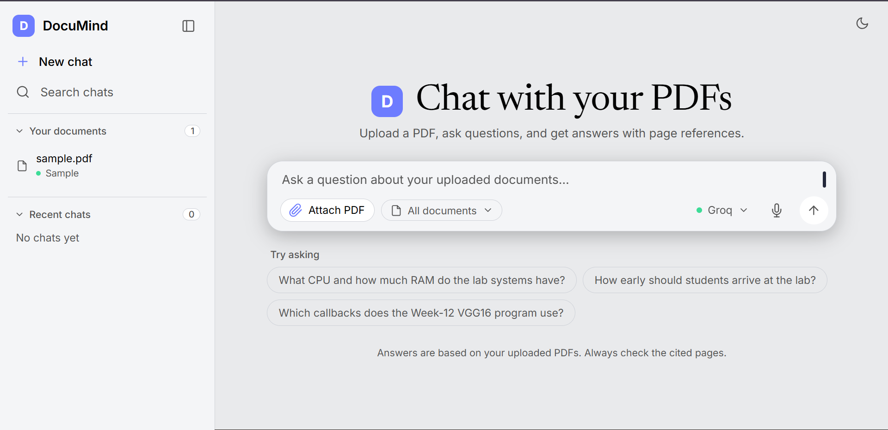
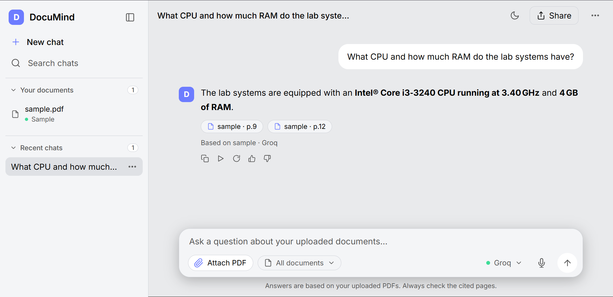
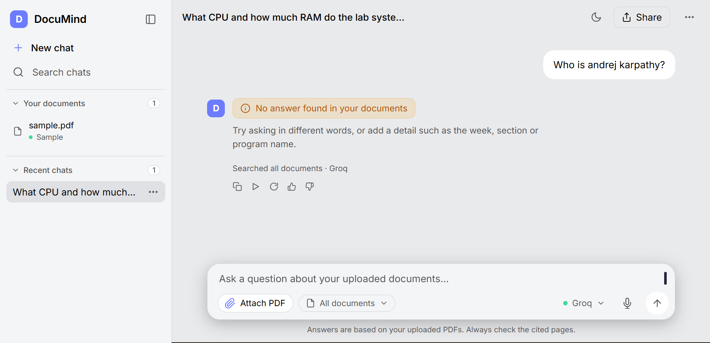

# DocuMind

Ask questions about your files and web pages and get answers with citations (page, slide or part). If the answer is not in the document, DocuMind says "I don't know" instead of guessing.

**Live demo:** https://documindai.duckdns.org (click "Try demo", no sign-up needed)





## Features
- Upload files and chat with them (answers cite the document and the page, slide or part)
- Strict answers: only from your documents, otherwise "I don't know"
- Follow-up questions work (chat memory) and answers can be regenerated
- Login, "Try demo" accounts, per-user documents, upload and rate limits
- Two LLMs to choose from (Groq or Gemini), with automatic backup if one is busy
- Light and dark theme, works on mobile, voice input on https
- Scanned (image-only) PDFs are detected and rejected with a clear message
- Many file types: PDF, Word, ODT, RTF, PowerPoint, EPUB, email, subtitles, HTML, JSON, XML, text, Markdown and code, plus public web pages by link
- Answers stream word by word, and hovering a source shows the exact passage
- One-click Summarise: a short summary of a whole document with references
- Sign up, sign in, forgot password by email, and delete my account
- Demo accounts and their files are cleaned up automatically after 48 hours


## How it works
```
File or web page -> read text -> split into chunks(1000 chars, 150 overlap) -> embeddings (all-MiniLM-L6-v2)
    -> Qdrant vector database
Question -> vector search + cross-encoder re-ranking + neighbour chunks
         -> strict prompt -> LLM (Groq gpt-oss-20b / Gemini) -> answer + citations
```
Stack: Python, FastAPI, LangChain loaders, Qdrant, sentence-transformers, React (Vite), Docker Compose, AWS.

## Evaluation
Tested on 3 documents with 30 questions each (90 in total): a 16-week Deep Learning lab manual and two research papers published in Scientific Reports (ECP-YOLO11n insulator defect detection, doi 10.1038/s41598-026-77328-5, and policy-gated firmware trust for UAV platforms, doi 10.1038/s41598-026-78674-0). For each document, 25 questions can be answered from the text and 5 cannot (they test "I don't know"). The expected answers and page numbers come from the document text.

Every question was asked once with Groq gpt-oss-20b: one fixed model, no backup model. Each answer was compared with the document text and graded by hand as correct, partly correct, wrong or, for unanswerable questions, correctly refused. Every question, answer and grade is listed on the Results page of the site.

| Document | Fully correct | Partly | Wrong | Correct "I don't know" | Right passage retrieved |
|---|---|---|---|---|---|
| Lab manual (used while building) | 19 / 25 (76%) | 3 | 3 | 5 / 5 | 24 / 25 |
| YOLO paper (new) | 23 / 25 (92%) | 2 | 0 | 5 / 5 | 24 / 25 |
| UAV paper (new) | 24 / 25 (96%) | 0 | 1 | 5 / 5 | 24 / 25 |
| The 2 new papers together | 47 / 50 (94%) | 2 | 1 | 10 / 10 | 48 / 50 |
| All documents | 66 / 75 (88%) | 5 | 4 | 15 / 15 | 72 / 75 |

"Right passage retrieved" means the text that holds the answer was among the passages given to the model (checked by exact text). The lab manual questions were used while building DocuMind, so that row is not a fair test. The two papers were new to the system.

What still goes wrong:
- In 4 lab manual answers the right text was retrieved, but the answer said the fact was not given (epoch counts, the final layers of the VGG16 program).
- For 3 of 75 questions the passage with the answer was not retrieved: the full lab index, a Discussion paragraph in the YOLO paper and the future-work sentence in the UAV paper.
- Small test: 90 questions, each asked once, written once from the document text. Good for finding weaknesses, not a formal benchmark. Grading is a judgement call, so every answer and note is published.

Gemini flash-lite was graded on the lab manual only, in an earlier round (20 / 25 fully correct). It was not run again.

Files in `eval/`: the questions (`questions.json` for the lab manual, `questions_yolo.json`, `questions_uav.json`), the raw outputs (`results_<doc>_groq.json`) and the grades (`grades_<doc>_groq.json`). The two papers are not stored in the repo; download them from the DOI links above.

Run it yourself (Qdrant running, one fixed model, no backup model):
```
python backend/store.py data/<file>.pdf     # once per document
python eval/run_eval_docs.py yolo_groq --questions eval/questions_yolo.json
```
Set `EVAL_MODEL=gemini` to evaluate Gemini instead of Groq.

## Run locally
```
docker compose up --build -d      # Qdrant + API + web on http://localhost:8000
```
Create a `.env` file (never commit it):
```
GROQ_API_KEY=your_key
GEMINI_API_KEY=your_key
```

## Privacy note
Questions and retrieved text are sent to the chosen LLM provider. Gemini's free tier may use content to improve Google products, so do not upload private documents when using it.

## Deploy (AWS EC2)
Runs on one EC2 server with Docker Compose and Caddy (automatic https).
```
sudo -i
cd DocuMind
git pull
docker compose up --build -d
docker compose ps
```
Put the same `.env` keys on the server. For password reset emails also add `SMTP_USER` and `SMTP_PASS` (a Gmail app password). If the `Caddyfile` changes, run `docker compose restart caddy`.

## Known limits
- No OCR (scanned PDFs and images are rejected), no Excel/CSV tables, no audio or video
- Word, PowerPoint and text files have no real pages, so citations show "part N" or "slide N"
- Free-tier LLM limits mean very busy days may show a "busy" message
- Long lists and counting questions can be incomplete

## Roadmap
- OCR for scanned PDFs and images
- Excel and CSV tables
- Audio, video and YouTube links (speech to text)

## Author
Korabu Naved Arif — [LinkedIn](https://www.linkedin.com/in/naved-korabu-2b8221434/) · [GitHub](https://github.com/MoghalPathan)
